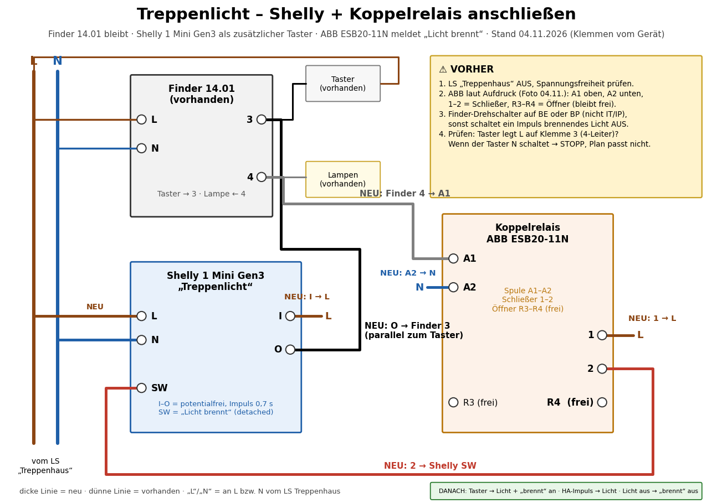

🇩🇪 [Deutsche Version](README.md)

# Stairwell light → Home Assistant (Shelly 1 Mini Gen3)

The stairwell light is driven by a **Finder 14.01** staircase timer in the distribution board. It should also be
switchable from Home Assistant (e.g. via motion sensors, or when the doorbell rings in the evening), and HA should
show whether the light is on. The Finder **stays**; a **Shelly 1 Mini Gen3** just briefly "presses the button" in
parallel to the existing push buttons. If the Shelly fails, buttons and timer keep working as before.

> **🟢 Status 2026-11-04: installed and tested.** Shelly, coupling relay and motion automation are running. The
> Finder was in IT/IP mode and is now set to **BP**. **Open:** more motion sensors (ground/2nd floor), "doorbell in
> the evening" automation.

| | |
|---|---|
| Device | Shelly 1 Mini Gen3 (terminals SW · O · I · L · N), same type as the [door opener](https://github.com/Sparxx947/shelly-tueroeffner) |
| Trigger | contact **I → O** in parallel to the stairwell buttons: I on the button phase (L), O to **Finder terminal 3** |
| Pulse | auto-off **0.7 s** (below 5 s, otherwise the Finder enters service mode ME/MP = 60 min permanent light) |
| "Light on" feedback | **coupling relay** 230 V (ABB ESB20-11N): coil **A1** to Finder terminal 4, **A2** to N; NO contact **1** to L, **2** to Shelly **SW**; NC contact R3–R4 unused. SW set to "detached" |
| Shelly supply | L/N from the "stairwell" circuit breaker |
| Finder 14.01 | mode **BP** (with switch-off warning; BE would work too) – **not IT/IP**, otherwise a second pulse switches a burning light OFF (found and measured that way) |
| Wiring diagram | [docs/schaltplan/treppenlicht_schaltplan.pdf](docs/schaltplan/treppenlicht_schaltplan.pdf) (A4 landscape, German labels, terminals read from the device) |
| Enclosure | 3D-printed DIN-rail enclosure, 2 modules – [docs/gehaeuse.en.md](docs/gehaeuse.en.md) |
| Firmware | stock Shelly, local, cloud off |

## Principle

```
CB "stairwell" ── L ──┬── Finder 14.01 L ── terminal 4 ──► lamps
                      │        terminal 3 ◄──┬── buttons GF / 1F / 2F (switch L)
                      │                      └── Shelly O   (I = L)  ← additional "button"
                      └── Shelly L                    terminal 4 ──► coupling relay coil ── N
                                                                     NO contact: L ──► Shelly SW
```

Why the coupling relay? Connecting SW directly to terminal 4 lets the leakage current of the Shelly input make LED
lamps glow when off (forum reports, not measured here).



Shelly L, Shelly I and relay terminal 1 need **the same phase** as the Finder ("stairwell" breaker). Easiest via a
WAGO on L (and one on N for Shelly N and relay A2). The Shelly terminals take only one wire each.

## Behaviour of the Finder 14.01 (measured 2026-11-04)

| Observation | Consequence |
|---|---|
| Run time T ≈ 3 min (dial), measured 187 s twice | – |
| In **IT/IP** a pulse while the light is on switches it **off** | changed to **BP** |
| In **BP** every further press **adds** a full run time (2 presses ≈ 2 × T); it does not restart the timer | the automation must not press on every motion |
| Switch-off warning: the light briefly goes off about 22 s and 11 s before the end (0.1–0.35 s) | "light on" flickers too – do not treat as "off" |
| The coupling relay releases cleanly when off | no glowing/holding from leakage current observed |

## Home Assistant

- `switch.…_treppenlicht_impuls` – the pulse (0.7 s auto-off in the Shelly). Do **not** use it as a state: 0.7 s is
  too short for the history.
- `binary_sensor.…_licht_brennt` – feedback via the coupling relay.
- Automation "Treppenlicht: bei Bewegung einschalten" (UI automation, mode *single* with 25 s cool-down):
  - motion detected **and** light off for ≥ 3 s → one pulse.
  - light flickers/goes off (warning) **and** the sensor still sees motion → one extra press (+ T).
  - motion while the light is on → nothing (the Finder would add run times).
  - conditions: switch "Treppenlicht per Bewegung" on, sun elevation below an adjustable value (default 3°) as long
    as the sensor has no light measurement.
- Test 2026-11-04: motion → light on after 0.25 s; motion while on → no pulse; flicker without motion → no pulse;
  flicker with motion → extra press.

## Safety

- **All terminals carry 230 V.** Work only de-energised (breaker off, verify absence of voltage). If in doubt: a
  qualified electrician.
- Printed PETG is **not** flame-retardant – see [fire safety](docs/gehaeuse.en.md#fire-safety--an-honest-assessment).
- After installation, check that the coupling relay releases reliably when off (here: yes, "light on" goes off reliably).

## Contents

| Path | Content |
|---|---|
| [docs/gehaeuse.en.md](docs/gehaeuse.en.md) | DIN-rail enclosure: design, differences to the door opener, checks, printing, fire safety |
| [docs/schaltplan/](docs/schaltplan/) | Wiring diagram as PDF/PNG and the Python script (matplotlib) that draws it |
| `gehaeuse/` | OpenSCAD source, STL (body, lid), ready 3MF for Bambu Lab P1S, view |

## License

MIT – see [LICENSE](LICENSE).
