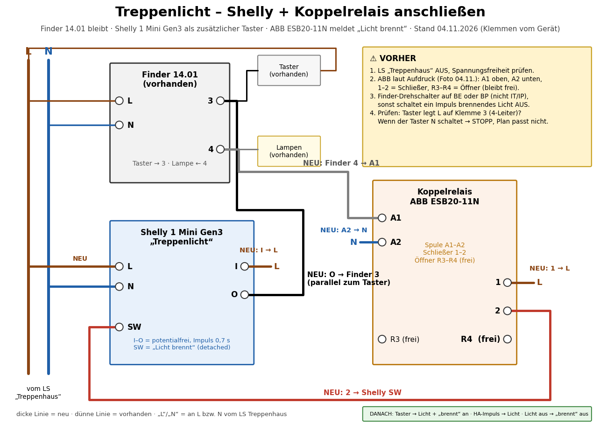

🇬🇧 [English version](README.en.md)

# Treppenhauslicht → Home Assistant (Shelly 1 Mini Gen3)

Das Treppenhauslicht hängt an einem **Finder 14.01** (Treppenlichtzeitschalter) im Verteiler. Es soll zusätzlich
aus Home Assistant einschaltbar sein, etwa per Bewegungsmelder oder abends beim Klingeln. HA soll außerdem anzeigen,
ob das Licht gerade brennt. Der Finder **bleibt**. Ein **Shelly 1 Mini Gen3** drückt nur parallel zu den
vorhandenen Tastern kurz „auf den Knopf“. Fällt der Shelly aus, funktionieren Taster und Zeitschalter wie bisher.

> **🟢 Stand 04.11.2026: eingebaut und getestet.** Shelly, Koppelrelais und Bewegungsautomation laufen. Der Finder
> stand auf IT/IP und ist jetzt auf **BP** umgestellt. **Offen:** weitere Bewegungsmelder (EG, E2), Automation
> „abends beim Klingeln“.

| | |
|---|---|
| Gerät | Shelly 1 Mini Gen3 (Klemmen SW · O · I · L · N), derselbe Typ wie beim [Türöffner](https://github.com/Sparxx947/shelly-tueroeffner) |
| Auslöser | Kontakt **I → O** parallel zu den Treppenhaus-Tastern: I an der Taster-Phase (L), O an **Finder Klemme 3** |
| Impuls | Auto-Off **0,7 s** (unter 5 s, sonst schaltet der Finder in den Servicemodus ME/MP = 60 min Dauerlicht) |
| Rückmeldung „Licht brennt“ | **Koppelrelais** 230 V (ABB ESB20-11N): Spule **A1** an Finder Klemme 4, **A2** an N; Schließer **1** an L, **2** an Shelly **SW**; Öffner R3–R4 bleibt frei. SW im Shelly „detached“ |
| Versorgung Shelly | L/N vom Leitungsschutzschalter „Treppenhaus“ |
| Finder 14.01 | Betriebsart **BP** (mit Ausschaltvorwarnung; BE ginge auch) – **nicht IT/IP**, sonst schaltet ein zweiter Impuls brennendes Licht AUS (so vorgefunden und gemessen) |
| Anschlussplan | [docs/schaltplan/treppenlicht_schaltplan.pdf](docs/schaltplan/treppenlicht_schaltplan.pdf) (A4 quer, Klemmen vom Gerät abgelesen) |
| Gehäuse | Hutschienengehäuse 2 TE zum Selbstdrucken – [docs/gehaeuse.md](docs/gehaeuse.md) |
| Firmware | Shelly-Original, lokal, Cloud aus (Tasmota: siehe Türöffner-Repo, praktisch nicht möglich) |

## Prinzip

```
LS „Treppenhaus“ ── L ──┬── Finder 14.01 L ── Klemme 4 ──► Lampen
                        │        Klemme 3 ◄──┬── Taster EG / E1 / E2 (schalten L)
                        │                    └── Shelly O   (I = L)  ← zusätzlicher „Taster“
                        └── Shelly L                    Klemme 4 ──► Koppelrelais-Spule ── N
                                                                       Schließer: L ──► Shelly SW
```

Warum der Umweg über das Koppelrelais? Hängt man SW direkt an Klemme 4, lässt der Leckstrom des Shelly-Eingangs
LED-Lampen im ausgeschalteten Zustand glimmen (Erfahrungen aus Foren, hier nicht nachgemessen).



Shelly L, Shelly I und Koppelrelais 1 brauchen **dieselbe Phase** wie der Finder (LS „Treppenhaus“). Am einfachsten
über eine WAGO auf L (und eine auf N für Shelly N und Koppelrelais A2). Die Shelly-Klemmen nehmen nur eine Ader.

## Verhalten des Finder 14.01 (gemessen am 04.11.2026)

| Beobachtung | Folge |
|---|---|
| Laufzeit T ≈ 3 min (Drehregler), zweimal 187 s gemessen | – |
| In **IT/IP** schaltet ein Impuls bei brennendem Licht **aus** | auf **BP** umgestellt |
| In **BP** **addiert** jeder weitere Druck eine volle Laufzeit (2 Drücke ≈ 2 × T), er startet die Zeit nicht neu | Automation darf nicht bei jeder Bewegung drücken |
| Ausschaltvorwarnung: Licht geht ca. 22 s und 11 s vor dem Aus kurz aus (0,1–0,35 s) | „Licht brennt“ flackert mit – nicht als „aus“ werten |
| Koppelrelais fällt im AUS sauber ab | kein Glimmen/Halten durch Leckstrom beobachtet |

## Home Assistant

- `switch.…_treppenlicht_impuls` – der Impuls (0,7 s Auto-Off im Shelly). **Nicht** als Zustand verwenden: 0,7 s
  sind zu kurz für den Verlauf.
- `binary_sensor.…_licht_brennt` – Rückmeldung über das Koppelrelais.
- Automation „Treppenlicht: bei Bewegung einschalten“ (UI-Automation, Modus *single* mit 25 s Nachlauf):
  - Bewegung erkannt **und** Licht seit ≥ 3 s aus → ein Impuls.
  - Licht flackert/geht aus (Vorwarnung) **und** Melder sieht noch Bewegung → einmal nachdrücken (+ T).
  - Bewegung bei brennendem Licht → nichts (sonst addiert der Finder Laufzeiten).
  - Bedingungen: Schalter „Treppenlicht per Bewegung“ an, Sonnenhöhe unter einem einstellbaren Wert (Standard 3°),
    solange der Melder keine Helligkeit misst.
- Test 04.11.2026: Bewegung → Licht nach 0,25 s an; Bewegung bei brennendem Licht → kein Impuls; Flackern ohne
  Bewegung → kein Impuls; Flackern mit Bewegung → nachgedrückt.

## Sicherheit

- **Hier liegt an allen Klemmen 230 V an.** Arbeiten nur spannungsfrei (LS „Treppenhaus“ aus, Spannungsfreiheit
  messen). Wer das nicht sicher kann: Elektrofachkraft.
- Gedrucktes PETG ist **nicht** flammhemmend – siehe [Brandschutz](docs/gehaeuse.md#brandschutz--ehrlich-eingeordnet).
- Nach dem Einbau prüfen, ob das Koppelrelais im AUS sicher abfällt (hier: ja, „Licht brennt“ geht zuverlässig aus).

## Inhalt

| Pfad | Inhalt |
|---|---|
| [docs/gehaeuse.md](docs/gehaeuse.md) | Hutschienengehäuse: Aufbau, Unterschiede zum Türöffner, Prüfungen, Druck, Brandschutz |
| [docs/schaltplan/](docs/schaltplan/) | Anschlussplan als PDF/PNG und das Python-Skript (matplotlib), das ihn erzeugt |
| `gehaeuse/` | OpenSCAD-Quelle, STL (Körper, Deckel), fertige 3MF für Bambu Lab P1S, Ansicht |

## Lizenz

MIT – siehe [LICENSE](LICENSE).
