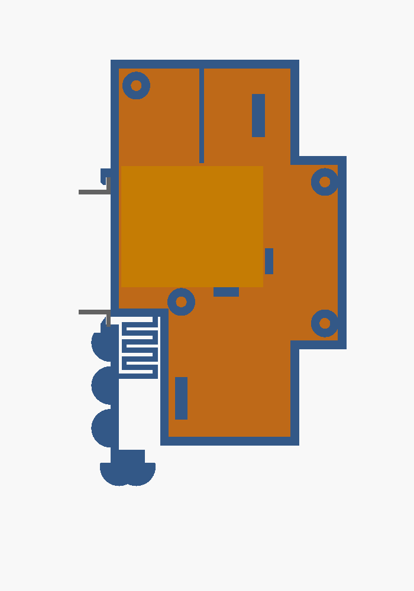

🇩🇪 [Deutsche Version](gehaeuse.md)

# DIN-rail enclosure (2 modules)

Same enclosure as the [door opener](https://github.com/Sparxx947/shelly-tueroeffner/blob/main/docs/gehaeuse.en.md),
because the same Shelly 1 Mini Gen3 sits inside. Shaped like a circuit breaker: **2 modules wide (34.6 mm), 90 mm
high, front collar 45 mm, shoulder 44 mm, total depth 55 mm** (DIN 43880 size 1), snaps onto TS35.
Source: [`gehaeuse/treppenlicht-gehaeuse.scad`](../gehaeuse/treppenlicht-gehaeuse.scad),
ready to print: `treppenlicht_koerper.stl` (body), `treppenlicht_deckel.stl` (lid).

## Differences to the door opener

| | Door opener | Stairwell light |
|---|---|---|
| Bottom entry (SW, O, I) | round hole Ø 5.5 (2 bell wires) | **slot 5.5 × 10 mm** – three single wires side by side: **I** (phase), **O** (→ Finder terminal 3), **SW** (← coupling relay) |
| Top entry (L, N) | Ø 6.5, power cord | Ø 6.5, two single wires from the breaker |
| Divider between I and L | safety separation 230 V / extra-low voltage | no safety separation (230 V everywhere); keeps wires apart and holds the Shelly down. **It splits the interior completely – I cannot be bridged to L inside**, hence a separate wire from below |
| Front label | „Türöffner“ | **„Treppenlicht“** |
| Checks | 3 | 4 – plus `pruef_loch` |

The slot width (5.5 mm, along the enclosure depth) is the same as on the door opener. Not much more would fit – the
latch block lies behind it (from 13.6 mm), the lid divider in front (from 20.75 mm), so at most about 7 mm. It is
therefore lengthened crosswise (along the rail). Designed for single wires H07V-K up to 1.5 mm² (outer Ø about
3 mm) with ferrules.

## Design

| Part | Purpose |
|---|---|
| Hook at the top (fixed) | grips behind the upper flange |
| Latch at the bottom with meander spring | snaps behind the lower flange. **Release:** screwdriver from the front into the slot of the tab, pull down (≈ 3 mm) |
| Shelly pocket | back against the left wall, terminal screws towards the lid, terminal strip at the top (from the back: SW O I L N) |
| Top front entry, Ø 6.5 | L, N from the breaker, cable-tie bar below |
| Bottom rear entry, slot 5.5 × 10 | I, O, SW, cable-tie bar next to it |
| Lid | right side wall, 4 self-tapping screws 2.9 × 13 |

## Checks (OpenSCAD)

Each check is an intersection and must be **empty or 0 mm³**.

| Check | Result 2026-11-02 | Alarm path proven with |
|---|---|---|
| `pruef_shelly` – Shelly vs. body + lid | 0 mm³ (contact only) | Shelly 3 mm lower → 213.6 mm³ |
| `pruef_riegel` – latch pulled 3 mm vs. body | empty | (door opener) |
| `pruef_schiene` – snapped-in rail vs. enclosure | 0 mm³ (contact only) | (door opener) |
| `pruef_loch` – slot vs. latch block + lid divider | empty | slot 9 mm wide → 282.1 mm³ |

## Printing

**Ready for Bambu Lab P1S:** [`gehaeuse/treppenlicht-gehaeuse-p1s.3mf`](../gehaeuse/treppenlicht-gehaeuse-p1s.3mf) –
body and lid on one plate, Bambu PETG Basic, Textured PEI Plate, 0.20 mm, 3 walls, 25 % infill, no supports, no
brim. Sliced: **1 h 55 min, 51.2 g**. Break off the five mouse ears on latch and tab after printing. **Do not enable
a brim in the slicer** – it welds the spring gaps shut. Pull the latch once by hand after printing.

The door-opener print (same geometry except hole and label) fitted on 2026-10-22 and snaps onto the rail. The
stairwell variant itself has **not been printed yet**.

## Fire safety – an honest assessment

Printed PETG is **not flame-retardant**, and here **all** terminals carry 230 V. Commercial DIN-rail enclosures are
polycarbonate UL94 V-0. For a compliant build, print in V-0 filament (PC-FR, PETG-V0) or use an empty enclosure:

| Enclosure | Size | Material | Price (reichelt, 2026-10-21) |
|---|---|---|---|
| CamdenBoss CNMB/2/KIT | 36 × 90 × 58 mm | PC, UL94 V-0 | €8.15 |
| apra-norm apraRail DB 2 | 36 × 90 × 58 mm | PC, UL94 V-0 | €7.30 |
