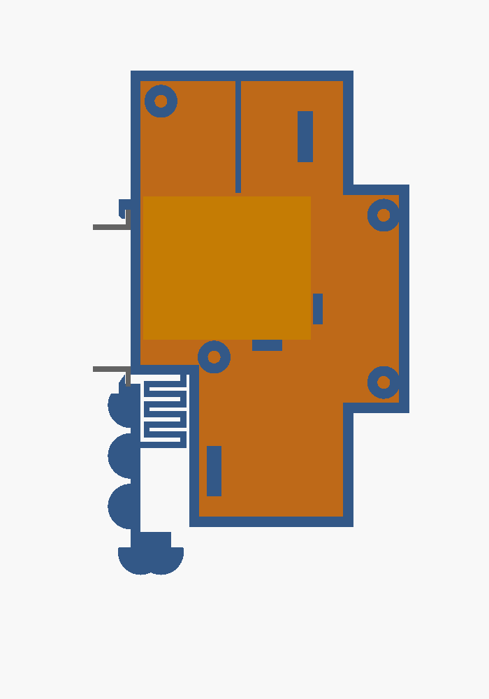

🇬🇧 [English version](gehaeuse.en.md)

# Gehäuse für die Hutschiene (2 TE)

Gleiches Gehäuse wie beim [Türöffner](https://github.com/Sparxx947/shelly-tueroeffner/blob/main/docs/gehaeuse.md),
weil derselbe Shelly 1 Mini Gen3 drinsitzt. Form eines Leitungsschutzschalters: **2 TE breit (34,6 mm), 90 mm
hoch, Frontkragen 45 mm, Schulter 44 mm, Gesamttiefe 55 mm** (DIN 43880 Baugröße 1), rastet auf TS35 auf.
Quelle: [`gehaeuse/treppenlicht-gehaeuse.scad`](../gehaeuse/treppenlicht-gehaeuse.scad),
druckfertig: `treppenlicht_koerper.stl`, `treppenlicht_deckel.stl`.

## Unterschiede zum Türöffner

| | Türöffner | Treppenlicht |
|---|---|---|
| Einführung unten (SW, O, I) | Rundloch Ø 5,5 (2 Klingeladern) | **Langloch 5,5 × 10 mm** – drei Einzeladern nebeneinander: **I** (Phase), **O** (→ Finder Kl. 3), **SW** (← Koppelrelais) |
| Einführung oben (L, N) | Ø 6,5, Euro-Anschlussleitung | Ø 6,5, zwei Einzeladern vom LS |
| Trennsteg zwischen I und L | Schutztrennung 230 V / Kleinspannung | keine Schutztrennung (überall 230 V); ordnet die Adern und hält den Shelly nach oben. **Er teilt den Innenraum ganz – I lässt sich innen nicht mit L brücken**, daher eigene Ader von unten |
| Beschriftung Front | „Türöffner“ | **„Treppenlicht“** |
| Prüfungen | 3 | 4 – zusätzlich `pruef_loch` |

Die Breite des Langlochs (5,5 mm, in Richtung der Gehäusetiefe) ist dieselbe wie beim Türöffner. Viel mehr ginge
nicht – dahinter liegt der Riegelblock (ab 13,6 mm), davor der Steg im Deckel (ab 20,75 mm), Platz also höchstens
gut 7 mm. Verlängert ist es deshalb quer dazu (in Schienenrichtung).
Ausgelegt für Einzeladern H07V-K bis 1,5 mm² (Außen-Ø etwa 3 mm), mit Aderendhülsen.

## Aufbau

*Blick auf die offene Seite (Deckel ab): links die Schiene (grau), rechts der Kragen. Orange ist der Shelly.*

| Teil | Zweck |
|---|---|
| Haken oben (fest) | greift hinter den oberen Flansch |
| Riegel unten mit Mäanderfeder | rastet hinter den unteren Flansch. **Lösen:** Schraubendreher von vorn in den Schlitz der Lasche unten, nach unten ziehen (≈ 3 mm) |
| Shelly-Tasche | Rücken an der linken Wand, Klemmschrauben zum Deckel, Klemmleiste oben (Reihenfolge von hinten: SW O I L N) |
| Einführung oben vorn, Ø 6,5 | L, N vom LS „Treppenhaus“, Kabelbinder-Steg darunter |
| Einführung unten hinten, Langloch 5,5 × 10 | I, O, SW, Kabelbinder-Steg daneben |
| Deckel | rechte Seitenwand, 4 Blechschrauben 2,9 × 13 |

## Prüfungen (OpenSCAD)

Jede Prüfung ist eine Schnittmenge und muss **leer bzw. 0 mm³** sein.

| Prüfung | Ergebnis 02.11.2026 | Alarmpfad belegt mit |
|---|---|---|
| `pruef_shelly` – Shelly gegen Körper + Deckel | 0 mm³ (nur Auflage) | Shelly 3 mm tiefer → 213,6 mm³ |
| `pruef_riegel` – Riegel 3 mm gezogen gegen Körper | leer | (Türöffner) |
| `pruef_schiene` – eingerastete Schiene gegen Gehäuse | 0 mm³ (nur Anlage) | (Türöffner) |
| `pruef_loch` – Langloch gegen Riegelblock + Deckelsteg | leer | Langloch 9 mm breit → 282,1 mm³ |

## Druck

**Fertig für Bambu Lab P1S:** [`gehaeuse/treppenlicht-gehaeuse-p1s.3mf`](../gehaeuse/treppenlicht-gehaeuse-p1s.3mf) –
Körper und Deckel auf einer Platte, Bambu PETG Basic, Textured PEI Plate, 0,20 mm, 3 Wände, 25 % Füllung, ohne
Stützen, ohne Brim. Gesliced: **1 h 55 min, 51,2 g**. Die fünf Mausohren an Riegel und Lasche nach dem Druck
abbrechen. **Keinen Brim im Slicer einschalten** – er schweißt die Federspalte zu. Nach dem Druck den Riegel einmal
von Hand durchziehen.

Der Türöffner-Druck (gleiche Geometrie bis auf Loch und Schrift) hat am 22.10.2026 gepasst und rastet auf der Schiene.
Die Treppenlicht-Variante selbst ist **noch nicht gedruckt**.

## Brandschutz – ehrlich eingeordnet

Gedrucktes PETG ist **nicht flammhemmend**, und hier liegt an **allen** Klemmen 230 V an. Gekaufte
Hutschienengehäuse sind aus Polycarbonat UL94 V-0. Wer es normgerecht will, druckt in V-0-Filament (PC-FR,
PETG-V0) oder nimmt ein Leergehäuse:

| Gehäuse | Maße | Material | Preis (reichelt, 21.10.2026) |
|---|---|---|---|
| CamdenBoss CNMB/2/KIT („CB HUTKIT 2“) | 36 × 90 × 58 mm | PC, UL94 V-0 | 8,15 € |
| apra-norm apraRail DB 2 | 36 × 90 × 58 mm | PC, UL94 V-0 | 7,30 € |
